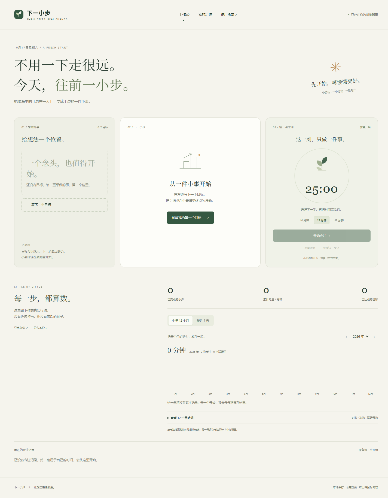

# 下一小步

一个把目标变成小行动的本地优先工具。原生 HTML / CSS / JavaScript，无外部字体、接口或运行依赖。

**电脑网页 + 安卓离线 App**，两端使用同一份界面和数据格式。网页版也支持手机浏览器；安卓安装包见仓库的 Releases。两端不自动同步，可以用 JSON 备份迁移。

写下一个目标，拆成今天能完成的小行动，再用一段专注时间开始。支持电脑和手机，无需注册，进度由你自己保存。



## 打开

下载仓库后，双击 `dist/index.html` 即可使用，无需安装依赖。

如已安装 Node.js，也可以在项目目录启动本地服务：

```sh
node serve.cjs
```

打开终端显示的地址（默认 `http://127.0.0.1:4177`）。数据按浏览器和访问地址隔离，文件方式与 localhost 不共享数据，请用导出/导入迁移。

首次使用时，创建目标并添加行动，点击某条行动后选择专注时长；行动做完后手动勾选完成。页面底部可以导出和导入 JSON 备份。

## 功能

- 多目标及行动列表，支持新增、编辑目标、删除、撤销完成。
- 学习、创作、求职三种可编辑行动模板；不会自动生成假进度。
- 10 / 25 / 45 分钟专注、暂停/继续、刷新恢复、提前完成。
- 累计统计、最近七天 / 全年十二个月视图，可切换历史年份。
- 每月专注时长、次数、活跃天数和全年合计；手机明细表可横向滑动。全部历史记录可导出。
- JSON 备份导入/导出，导入前校验和二次确认，异常存储保护。
- 手机布局、键盘操作、减少动态效果支持。
- 安卓 APK 内置页面，离线运行；通过系统文件选择器导入和导出备份。

## 安卓安装与迁移

在 [Releases](https://github.com/zyy051206/next-small-step/releases) 下载 `next-small-step-1.1.0.apk`，传到安卓手机并打开安装。支持 Android 8.0 及以上，建议使用更新后的 Android System WebView。手机可能要求允许此次来源安装应用。

电脑已有进度：先在原网页点“导出备份”，把 JSON 文件传到手机，再在 App 中点“导入备份”。导入会在确认后替换目标设备的现有数据，不会自动合并。卸载 App 会清除其本地数据，请先备份。iPhone 可使用网页版本，不能安装 APK。

计时切到后台或锁屏后按实际时钟计算，回到 App 时恢复显示或补记结束；**不提供后台到时通知**。

安卓源码、构建和签名说明见 [android/README.md](android/README.md)。GitHub Actions 会构建 APK 并用 Android 模拟器验证离线页面与数据持久化。CI 的 debug APK 仅供测试，正式交付包使用固定本地签名。

## 数据说明

数据位于当前浏览器的 localStorage（键 `next-small-step.v1`），不上传，也不跨设备同步。清理浏览器数据可能丢失记录，请定期导出备份。计时按时钟推进，浏览器关闭后仍会计算，到期在下次打开时记录；它不测量用户活动。暂停期间不计时。计时结束不自动完成任务。统计的“完成小步”和“达成目标”来自当前保留目标；删除目标后其专注历史仍保留。应用只保留一个活动计时。

`dist/core.js` 是可复用的数据校验、日期和计时逻辑；`dist/app.js` 管理交互与存储；`dist/style.css` 定义响应式界面。所有用户内容都以纯文本渲染。

## 验证

逻辑测试需要 Node.js：

```sh
node --test tests/core.test.cjs
```

浏览器流程测试需要 Windows、Microsoft Edge 和支持全局 `WebSocket` 的 Node.js（建议 Node.js 22 或更高版本）：

```sh
node tests/browser.cjs
```

浏览器测试使用 Edge 的默认安装路径 `C:/Program Files (x86)/Microsoft/Edge/Application/msedge.exe`，并通过 CDP 检查真实交互；若 Edge 安装位置不同，需要调整 `tests/browser.cjs` 中的路径。测试使用 `.qa/` 下的隔离浏览器目录，不访问个人浏览器数据。
